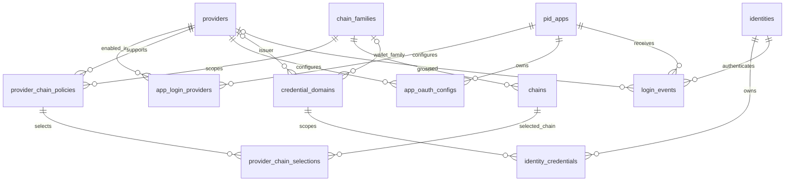

# Provider catalogue, chain policies, and login history

Implemented locally on 2026-11-19. Migration: `20261119_provider_catalog`.
This supersedes the proposed per-provider columns on `pid_apps` and its previous
`loginMethods` storage array. The API keeps `loginMethods` as a derived view for
existing clients. This is not a production deployment.

## Model

- `providers`: one row per login provider; code, name, nullable `image_url`,
  category (`web2`/`web3`), protocol, availability. Google/Apple/Discord and
  Phantom/MetaMask share this catalogue. Passkey and email are Web2 methods,
  but their protocols are not OAuth.
- `app_login_providers`: PK `(appId, providerCode)`. Presence means enabled;
  no second enabled flag or stored array. Both foreign keys are enforced.
- `credential_domains`: scopes credential uniqueness to an OAuth/email issuer
  or chain family. The legacy `identity_credentials.provider` column now has a
  foreign key here; it is NOT the wallet-extension brand.
- `identity_credentials`: existing unique `(provider, providerUserId)` and PID
  relationship are retained. One normalized EVM address used through two
  extensions stays one credential and PID. Passkey credentials remain in the
  existing `authorities` structure; no duplicate credential copies were added.
- `chain_families`: namespace catalogue; `eip155` and `solana` are distinct.
  Existing `chains` has FK namespace and unique `(namespace, reference)`.
- `provider_chain_policies`: unique `(providerCode, namespace)`, with `all` or
  `selected` mode. `all` means the family, never every blockchain. It also
  encompasses future chains in that family; use it only with that intention.
- `provider_chain_selections`: PK `(policyId, chainId)`. Only selected mode may
  have rows; chain namespace must match policy namespace. Triggers protect both
  child writes and parent classification/namespace changes.
- `app_oauth_configs`: PK `(appId, providerCode)`; client ID, encrypted-secret
  envelope, rotation timestamp. Only OAuth providers allowed. Storage contract
  only: no custom OAuth credential setter or exchange runtime is shipped here.
- `login_events`: one successful app SSO exchange per unique `exchangeId`.
  References app, PID and nullable provider. No copied user name, email or icon.
  Events and `app_users` summary update in one transaction, after exchange.

The two optional credential-domain parents are exclusive: exactly one must be
present (CHECK constraint). OAuth authentication can lead to Peridot wallet
provisioning; OAuth itself is not a wallet and does not own external keys.
Provisioning and chain accounts remain separate existing models.

## Examples of chain configuration (illustrative, not vendor claims)

| Intended support | Policy | Selections |
| --- | --- | --- |
| All EVM | namespace=eip155, mode=all | none |
| Only two EVM networks | namespace=eip155, mode=selected | those two chain IDs |
| EVM plus Solana | separate policies for eip155 and solana | per policy mode |
| Another family | add family, chains, provider policy | does not implement a new SDK adapter |

Actual seed: three empty selected policies (Phantom EVM, Phantom Solana,
MetaMask EVM). There are **zero configured chain selections**. These policies
are metadata only and are not yet enforced by signing/transfer routing. Empty
selected policies mean unconfigured, not an assertion of all-network support.
Current wallet login connectors handle Phantom Solana/EVM and MetaMask EVM;
that is a statement about repository adapters, not all vendor capabilities.

## Attribution and visibility

- Updated SDK/hosted/embed flows send `providerCode`; it is saved in the server
  challenge, carried through claim/SSO, then written on successful exchange.
- Google/email/passkey events use `providerEvidence=server`. Wallet events use
  `client_selected`: signatures prove address ownership, not extension brand.
- Old clients, old pending codes, and reused sessions without method context
  remain `unknown`. Never infer Phantom from Solana or MetaMask from EVM.
- Developer Users shows the latest recorded provider for that app/PID only.
  `GET /v1/apps/:id/logins?page=1` provides paginated history after ownership
  checks; machine tokens cannot use this owner route.
- `GET /v1/admin/logins` provides admin history with `appId`, `pid`,
  `provider`, `evidence`, `from`, `to` filters, rendered at
  `/admin/login-activity`.
- `GET /v1/providers` exposes catalogue metadata, never OAuth secrets.
- Admin `PATCH /v1/admin/providers/:code` edits `name`/`imageUrl` and toggles
  `isAvailable`; enabling requires an implemented adapter and complete OAuth
  configuration. Admin `PUT /v1/admin/providers/:code/chains/:namespace`
  atomically replaces policy using `{mode, chainIds}`. Provider `code`,
  `protocol` and `category` are immutable.
- The browser session now carries the authenticating provider (`method` claim,
  written from `Device.authMethod`), so session reuse and the hosted consent
  flow are subject to the same app switches as a fresh login. A token without
  method context is rejected for app-bound codes instead of bypassing switches.
- First-party sessions without an app SSO exchange are not tracked by these new
  events. Existing session/security records remain separate.
- Recording remains best effort: DB errors log a warning without failing an
  already successful login. No historical event backfill or durable retry queue.

## Normalization assessment

The app/provider and provider/chain relationships have atomic memberships,
composite unique keys and enforced references. Names/icons exist once, and
wallet-brand metadata is not copied into identity credentials. Repeated login
rows represent different events, not duplicate users. One PID may correctly
have app memberships in multiple apps and monthly rows in multiple months.

This is **not a claim that the entire schema is strict 3NF**:

1. `providers.category` is redundant with the current protocol classification.
   It is retained as the requested explicit column and constrained with CHECK;
   protocol/category changes are forbidden. Strict 3NF would move the mapping
   into a protocol catalogue or derive category in a view.
2. `app_users` first/latest timestamps and monthly MAU are deliberate projections,
   not additional identity sources. Their legacy FK gaps documented in the audit
   remain; the new event table does have FKs.
3. `exchangeId` is a unique retained audit reference, not an FK to short-lived
   `sso_codes`, which can be cleaned up.
4. The wider audit's authority uniqueness and other domain issues are not fixed
   by introducing providers. Existing financial/history snapshots are retained.

## Verification and remaining scope

Local migration preserved the existing app's memberships: legacy wallet became
Phantom + MetaMask, yielding five memberships. Seven providers were seeded;
Apple/Discord remain unavailable. All image URLs are NULL until actual owned or
approved asset URLs are configured. No invented remote icon URLs.

Live DB rollback probes verified duplicate/unknown memberships rejected,
OAuth chain policies rejected, wrong-family selections rejected, valid
selections accepted, all-mode conflicts rejected, parent invariants protected,
and new apps receive five defaults. Probe rows were rolled back.

Remaining: populate real icons and verified network policies; decide enforcement
semantics; implement custom OAuth runtime if needed; cover first-party login
events; complete wider audit fixes. Discord/GitHub adapters are declared in the
registry but not implemented, so they cannot be enabled. Wallet brands cannot be
cryptographically attested by ordinary address signatures.

## Admin provider catalogue (same day, additive)

Migration `20261119_provider_catalog_oauth` adds `platform_oauth_configs`
(provider code PK, client ID, `enc:v1:` secret envelope, scopes, server-derived
redirect URI, rotation timestamp). CHECK constraints reject plaintext secrets
and non-TLS redirects outside loopback; a trigger allows OAuth providers only.

- Runtime capability is code, not a column: `apps/api/src/auth/provider-adapters.ts`
  maps provider code → adapter, protocols and namespace. `implemented: false`
  (Discord, GitHub today) means no runtime, so `isAvailable` cannot be enabled.
- OAuth endpoints/scopes are code-owned constants; admins supply only client ID,
  secret and optional scope list. There is no admin-supplied authorization or
  token URL (SSRF surface removed by construction).
- Google runtime reads the DB row first and falls back to
  `GOOGLE_CLIENT_ID`/`GOOGLE_CLIENT_SECRET`; a present-but-broken DB row fails
  closed rather than silently using a stale env client. Both the start guard and
  the catalogue readiness check require the provider to be globally enabled.
- Every admin route (`/v1/admin/providers*`, `/v1/admin/chain-families*`,
  `/v1/admin/logins`) uses `JwtAuthGuard` + `AdminGuard`; anonymous, non-admin
  and machine/app tokens are rejected server-side. UI route gating is cosmetic.
- Dashboard routes: `/admin/providers` (list), `/admin/providers/new` (create),
  `/admin/providers/:code` (display + availability, OAuth client form,
  per-family chain policy), `/admin/chain-families` (families with their chains),
  `/admin/login-activity` (filtered history). Developer Integrations now reads
  `GET /v1/providers` and shows Web2/Web3 groups, protocol labels (passkey/email
  are not OAuth), readiness and switch state.
- Wallet login and the embedded modal filter on the same catalogue: only ready,
  globally enabled, app-enabled, client-supported providers are shown; icons come
  from `image_url` with an initial-letter fallback, rendered as `` with
  `crossOrigin="anonymous"` and `referrerPolicy="no-referrer"` (no SVG/HTML
  injection, no credential leak to asset hosts). Accepted icon URLs are https or
  same-origin paths ending in a raster extension (`png/jpeg/webp/gif/avif`);
  SVG and non-image schemes are rejected. Asset byte-size is not fetched
  server-side (that would reintroduce an SSRF surface), so size is a CDN-side
  concern.
- No client-side catalogue cache: each page/mount fetches `GET /v1/providers`,
  so an admin change is visible on the next mount; there is no stale local copy
  to invalidate.
- Config changes are audited through the existing `SecurityEventService.log`
  (`provider.created`, `provider.updated`, `provider.oauth.configured`,
  `provider.chains.updated`, `chain-family.created`) with non-secret fields and
  a `secretRotated` marker only. Secrets, tokens and codes never appear in read
  responses, logs or audit metadata.
- Per-app OAuth overrides (`app_oauth_configs`) remain storage-only; runtime
  configuration is platform-level because the shipped adapters do not support
  per-app client credentials.

Validation: workspace typecheck passed; targeted API auth/usage tests 214/214;
dashboard tests 26/26; embedded React tests 19/19; SDK directory tests 2/2.
OpenAPI route coverage reports zero public-route gaps. Local migration status is
up to date (83 migrations). Post-migration duplicate/orphan aggregate checks
reported zero for the audited keys; the local dataset is small (two identities,
one app), so this is not proof about production data or every possible invariant.
Strict full-spec YAML parsing also exposed a pre-existing duplicate response-key
block under sponsored withdrawal (reproduced in HEAD). New provider paths parse;
this unrelated baseline documentation defect remains. Coverage success is not
claimed as full OpenAPI schema validation.

## Feature matrix

| Feature | Table | Endpoint | UI | Access check | Test | Limitation |
| --- | --- | --- | --- | --- | --- | --- |
| Provider list | `providers`, `chain_families`, `provider_chain_*` | `GET /v1/providers` | wallet login, embed modal, Integrations | public | `providers.spec.ts`, wallet/dashboard tests | unready rows still returned |
| Provider create | `providers`, `credential_domains` | `POST /v1/admin/providers` | `/admin/providers/new` | `JwtAuthGuard`+`AdminGuard` | `providers.spec.ts` | new row starts disabled |
| Provider edit / enable | `providers` | `PATCH /v1/admin/providers/{code}` | `/admin/providers/:code` | admin only | `providers.spec.ts` | enable blocked without adapter/config |
| OAuth client config | `platform_oauth_configs` | `GET`/`PUT /v1/admin/providers/{code}/oauth` | `/admin/providers/:code` | admin only | `providers.spec.ts` | only implemented adapters (Google today) |
| Chain policy | `provider_chain_policies`, `provider_chain_selections` | `PUT /v1/admin/providers/{code}/chains/{namespace}` | `/admin/providers/:code` | admin only | `providers.spec.ts` | metadata only; not enforced in signing routes yet |
| Chain families | `chain_families`, `chains` | `GET`/`POST /v1/admin/chain-families` | `/admin/chain-families` | admin only | `providers.spec.ts`, dashboard test | chain creation stays on `/admin/chains` |
| Admin login history | `login_events` | `GET /v1/admin/logins` | `/admin/login-activity` | admin only | `providers.spec.ts` | legacy rows `unknown`; first-party logins untracked |
| App login history | `login_events` | `GET /v1/apps/{id}/logins` | app Users | owner user session | `providers.spec.ts` | machine tokens refused |
| Per-app switches | `app_login_providers` | `PATCH /v1/apps/{id}` (`loginMethods`) | Integrations | owner session | `apps.service.spec.ts`, `sso.service.spec.ts` | requires method context; legacy tokens rejected |
| Method attribution | `sessions`, `login_events` | login paths + SSO issue | — | server-derived | `sso.service.spec.ts` | wallet brand stays `client_selected` |
